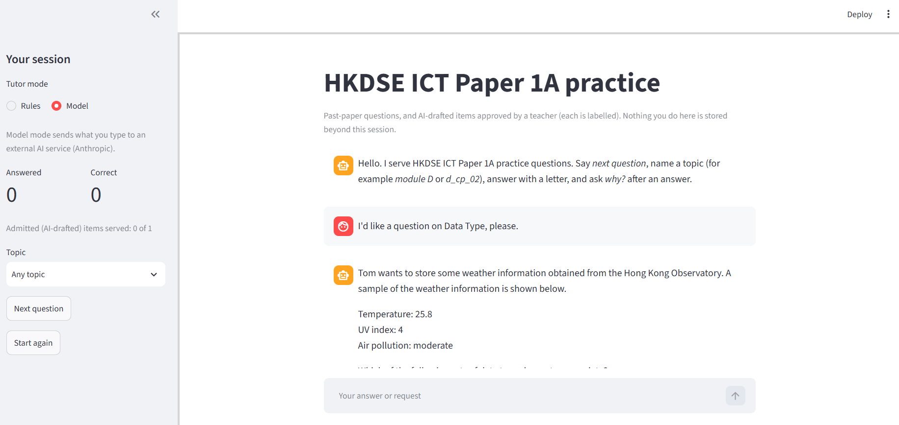

# Industry-Integrated AI Systems Synthesis: A Governed Question Lifecycle for HKDSE ICT Paper 1A

MSc in AI, Capstone #7 Final Synthesis Project.

The system classifies, extends, checks and serves multiple-choice practice questions for the HKDSE ICT Paper 1A under teacher governance. The primary artifact is the notebook `integrated_system_v1.7.ipynb`. The reusable logic lives in `src/`, and the Streamlit chat page in `app/` calls the same code.

It integrates methods from four earlier capstones:

| Capstone | Used for |
|---|---|
| C2 Statistical Analysis | Gap detection, Welch's t-test, Hedges' g, Wilson interval |
| C3 Machine Learning | Question classifier (TF-IDF with a linear model, temporal split, abstention) |
| C5 Generative AI | Candidate generators and the bake-off (LoRA TinyLlama, Gemma 4 E4B, Claude Haiku) |
| C6 Agentic AI | The student-side tutor: a rule router, and a language-model Orchestrator with one Explainer worker |

The student-side tutor is agentic (Section 4.13 of the notebook). In Model mode a bounded Orchestrator and one Explainer worker run on Claude Haiku 4.5 (`claude-haiku-4-5-20251001`) through the Anthropic API, and Haiku is also one of the three generators in the bake-off. Rules mode, the classifier and the gate call no language model. The key is read from `ANTHROPIC_API_KEY`; `.env.example` shows the format. The live run with the real model (twelve messages through both the rule router and the LLM Orchestrator, and one Explainer session) is recorded in Section 4.13.11 of the notebook.

<div align="center">
  <a href="doc/app_ui.png">
    
  </a>
</div>

## Links

- Kaggle dataset (the data files not kept in this repository): [capstone7_data](https://www.kaggle.com/datasets/stansir/capstone7-data)
- Repository: [PHIacademy/msai-capstone-synthesis-project](https://github.com/PHIacademy/msai-capstone-synthesis-project)

## Folder layout

```
.
|-- README.md
|-- requirements.txt                 direct dependencies (no GPU libraries)
|-- .gitignore
|-- .env.example                     template for the API key (copy to .env)
|-- integrated_system_v1.7.ipynb     the submission notebook (executed)
|-- kaggle_bakeoff.ipynb             Kaggle notebook that ran the generator bake-off (executed)
|-- module_summary.pdf               the Reflective Synthesis Paper (PDF)
|-- architecture_diagram.png         system architecture diagram
|-- tutor_agent_architecture.png     tutor and agents diagram
|-- app/
|   `-- streamlit_app.py             chat page for the student
|-- config/
|   `-- generators.json              the four generator backends
|-- data/
|   |-- taxonomy.csv                 26 sub-topics in 5 modules
|   |-- fields_explanation.md        schema of the question bank (v1.7)
|   |-- final_dataset.csv            NOT in git: from Kaggle (HKEAA past papers)
|   |-- ict_curriculum.md            NOT in git: from Kaggle (HKEAA curriculum guide)
|   |-- question/                    NOT in git: from Kaggle (question images)
|   `-- state.sqlite                 NOT in git: the governed store
|-- docs/
|   `-- app_ui.png                   screenshot of the student chat page
|-- models/
|   `-- c5_adapter/                  LoRA adapter (adapter_config.json, adapter_model.safetensors)
|-- outputs/
|   |-- bakeoff/kaggle2/             the 54 bake-off candidates, summary and environment files
|   |-- *_manifest.csv               sample and review lists
|   `-- *_filled.xlsx                NOT in git: returned teacher sheets
|-- scripts/
|   `-- bakeoff_runner.py            runs the bake-off (used on Kaggle)
|-- src/
|   |-- data.py                      loading the bank, shared definitions
|   |-- store.py                     SQLite governed store, effective bank
|   |-- stats.py                     gap detection and the batch-level tests
|   |-- classifier.py                module and sub-topic classifier
|   |-- review.py                    blind sheet and label review sheet
|   |-- generator.py                 backend-agnostic candidate generator
|   |-- gate.py                      deterministic checks 1 to 6 (no model)
|   |-- candidate_review.py          candidate review sheet and import
|   `-- tutor/                       Tutor, rule router, Orchestrator and Explainer
|-- tests/                           15 test files (254 tests)
```

## Setup

The notebook was run on Python 3.12.

1. Create and activate a virtual environment, then install the packages:

   ```
   python -m venv .venv
   .venv\Scripts\activate          # Windows; on macOS or Linux: source .venv/bin/activate
   pip install -r requirements.txt
   ```

2. Download the Kaggle dataset ([capstone7_data](https://www.kaggle.com/datasets/stansir/capstone7-data)) and place its files in the folders shown above (`data/` and, if included, `outputs/`). The past-paper questions, images and curriculum guide are material of the Hong Kong Examinations and Assessment Authority (HKEAA); their source and copyright are stated on the dataset page.

3. Optional: to use the language-model router (Model mode) or to re-run the live cells, copy `.env.example` to `.env` in the project root and replace the placeholder with your `ANTHROPIC_API_KEY` (or set it in the environment). Nothing else needs a key.

## Running

All paths are relative to the project root, so start every command from it.

- **Notebook.** Open `integrated_system_v1.7.ipynb` and run it from top to bottom. The stored outputs are from one such run. Cells that need the key or the returned teacher sheets are skipped with a message if those are missing, and the stored output remains.
- **Chat page.**

  ```
  streamlit run app/streamlit_app.py
  ```

  The page reads `data/state.sqlite` read-only. "Rules" mode needs no key; "Model" mode is offered only when `ANTHROPIC_API_KEY` is set.
- **Bake-off (optional).** `kaggle_bakeoff.ipynb` generated the 54 candidates on Kaggle. It trains nothing; it only generates text. The stored outputs are from the run `kaggle2`, and the repository already holds its results, so this step is only needed to repeat the run.
  1. Open the notebook on Kaggle with the accelerator set to GPU T4 x2 and Internet on.
  2. Attach the data dataset ([capstone7_data](https://www.kaggle.com/datasets/stansir/capstone7-data); it supplies `final_dataset.csv`, `ict_curriculum.md` and `taxonomy.csv`) and a private dataset holding one copy of each of `src/data.py`, `src/generator.py`, `config/generators.json`, `scripts/bakeoff_runner.py`, `models/c5_adapter/adapter_config.json` and `models/c5_adapter/adapter_model.safetensors`.
  3. Add the Kaggle secret `ANTHROPIC_API_KEY` (needed for Haiku). `HF_TOKEN` is optional and is only needed if a model page asks for its terms to be accepted.
  4. Run the cells from top to bottom. The notebook installs its own packages, runs a smoke test with one candidate per backend, then runs the six targets with three candidates each through the three backends (54 candidates). If Gemma 4 fails to load, the notebook has one optional cell that upgrades `transformers`; run it, restart the session and start again from the top.
  5. Download `bakeoff_bundle.zip` from the notebook's output panel (one JSONL file per backend, `summary.json` with the sampling used, and `environment.json`). Place its files in `outputs/bakeoff/<run id>/`, as for `kaggle2`, and run the bake-off sections of the main notebook (Sections 4.7 and 4.8) to store the candidates and run the gate.
- **Tests.**

  ```
  python -m pytest -q tests
  ```

  The expected result is 254 passed. The tests need `data/final_dataset.csv` and `data/taxonomy.csv`. A few skip themselves when an input is missing (the store, the curriculum guide, a returned sheet, Streamlit).

## What is and is not reproducible here

- The tests use a stub client and no network. They check the logic of the system (governance rules, the gate, the parser, refusals of bad sheets, the tutor's safeguards), not the behaviour of the live models. The bake-off ran on Kaggle with two T4 GPUs and an API key. The repository holds the notebook that ran it (`kaggle_bakeoff.ipynb`), the files it wrote (`outputs/bakeoff/kaggle2/`) and the runner (`scripts/bakeoff_runner.py`). `requirements.txt` does not include the GPU libraries (`torch`, `transformers`, `peft`, `accelerate`).
- The teacher's returned sheets and the governed store carry the reviewer's decisions and are not published. The notebook shows their results.

## Notes

- The official question bank is never edited. Everything that changes lives in `data/state.sqlite`, and the tutor opens it read-only.
- Generated questions are provisional until a teacher approves them, and an approved one is shown with the label "AI-drafted, teacher-approved, not an HKEAA question".
- Appendix A of the notebook lists the limitations and the decisions kept. 
